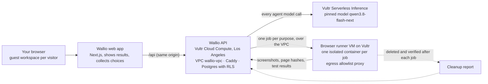

# Wallio architecture

Every model call and every browser session runs on Vultr. Nothing runs on the user's machine except the web page.

## The pieces

| Piece | Where | What it does |
|---|---|---|
| Web app (`web/`) | Next.js. Locally on `localhost:3000`, proxying `/api` to the API | Landing page at `/`, the app at `/home`. Displays what the API returns and collects choices. Never does billing arithmetic, scoring or policy itself |
| API (`packages/api`) | Vultr Cloud Compute vc2-2c-4gb, Los Angeles, in VPC `wallio-vpc`. Only Caddy is public (443) | Guest sessions (one workspace per visitor, Postgres row-level security), inventory, profile, run orchestrator with leases and deadlines, spend caps, approvals, recommendations, evidence. Streams run events over SSE |
| Inference | Vultr Serverless Inference, model pinned to `qwen3.8-flash-next` | Research planning, extraction, verification, explanations, and the owned demo task |
| Browser runner | A separate Vultr VM on the same VPC (Adhvik's daemon) | One isolated browser container per job. An egress proxy allows only that job's hosts, so private ranges, link-local and cloud metadata addresses are always denied. Every job is cleaned up and the cleanup is verified before the next starts |
| Owned pages | `eval.`, `forms.` and `hostile.` subdomains served by the API | The demo task page, the synthetic trial form behind the approval gate, and the hostile page for the containment test |

## One comparison, step by step

1. The web app posts `POST /api/comparisons` with the profile version, workflow, task and tools, plus a spend cap.
2. The API queues the run and streams events from `GET /api/runs/:id/events`: stages (planning, researching, testing, verifying, reporting), browser steps, evidence captured, each inference call, policy denials and cleanup.
3. The runner researches each tool's official pages, capturing a screenshot, a bounded excerpt and a content hash for each page.
4. The owned task runs through Vultr inference on Wallio's eval page; the runner reads and screenshots the pass or fail.
5. The API writes a recommendation in which every factual statement cites evidence or something the user said. Unknowns stay unknown.
6. Any outward action (the synthetic trial request) pauses for approval. The user sees the exact fields and destination, and approval binds to a hash of that intent. A second approval of the same intent is rejected.

## Blast Radius Zero

The containment run (`POST /api/containment-runs`) opens Wallio's own hostile page. The page tries a prompt injection and links to a private address. Policy refuses the actions, the egress proxy denies the requests, a sentinel on the control plane stays unchanged, and the runner reports the container and volume removed.

## Today

The API runs on Vultr in demo playback mode (`/api/health` reports `runMode`). Approvals, replay rejection and policy decisions are real; browsing and model calls inside runs are played back until the live runner is switched on. The web app labels every sample screen as sample data.
