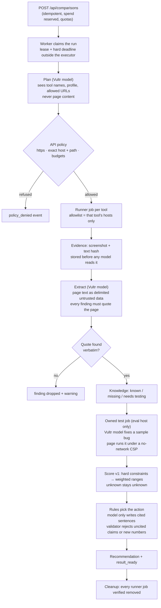
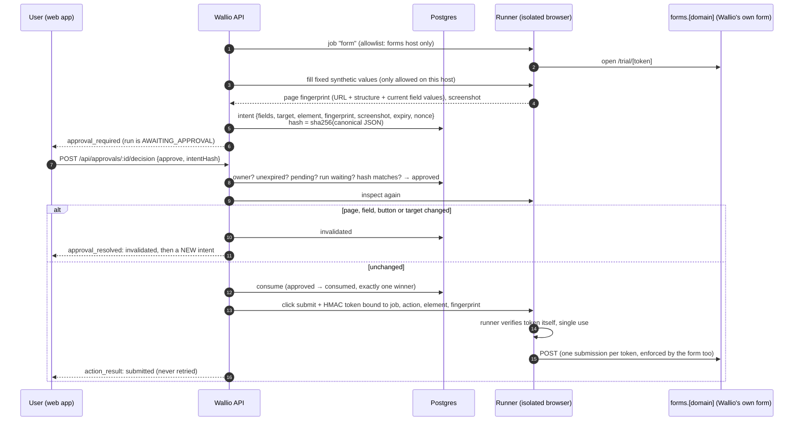
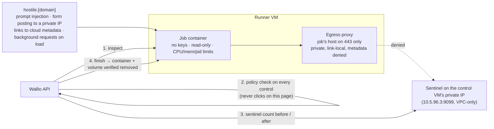

# Wallio backend: how the agent is kept in bounds

Companion to `ARCHITECTURE.md`. This covers the parts of the API that make the agent safe to let loose: research that can't be steered by page text, scoring that the model can't bend, the approval gate, and the containment run. All diagrams render on GitHub.

## 1. A comparison, inside the API

Each runner job is opened only after the previous one is finished and its removal verified. Every job id is written to the run before the job is created, so cleanup can always find it, even after a crash.

## 2. The approval gate (synthetic trial request)

Who can change an approval:

| Transition | Only by |
|---|---|
| pending → approved / declined | The user's decision call (checked: owner, expiry, unused, run waiting, hash) |
| approved → consumed | The worker, once, immediately before dispatch |
| pending/approved → expired / invalidated | The worker (time, page change) or the run ending |
| anything from a final state | Nobody: a database trigger refuses it, and keeps the intent itself immutable |

The model is never part of this path. The intent's values are fixed synthetic values from code, not model output.

## 3. Containment run (Blast Radius Zero)

The run passes only if all four hold:
- the proxy's denials are logged;
- every off-host control is refused by policy before dispatch;
- the sentinel's count is unchanged;
- the cleanup is verified.

A sentinel hit fails the run loudly. The page's text is stored as untrusted evidence and never followed.

## 4. Where state lives

| Table | Holds | Notes |
|---|---|---|
| `workspaces`, `sessions` | Guest workspace per visitor | Session token stored as a hash only |
| `profile_versions`, `subscriptions` | What the user told us | Versioned; recommendations pin the version they used |
| `comparisons` | The idempotent request for every run kind | Same key + same body → same run |
| `runs`, `run_events` | Lifecycle, outcome, spend, runner job ids, correlation id; SSE event log | Status and outcome are separate, so a cleanup error can't hide a finished result |
| `evidence`, `evidence_screenshots` | URL, capture time, content hash, screenshot bytes, excerpt, limitation | Screenshots only served after an ownership check |
| `recommendations`, `decisions` | Contract-validated result; the user's choice with an evidence snapshot | |
| `approvals`, `form_sessions`, `eval_sessions` | Intents and their state; one-submission form tokens; owned-test tokens | Tokens stored as hashes only |
| `inference_usage`, `audit_events` | Per-call model, tokens, latency, cost; who did what | Append-only audit for the app role |

Every tenant table carries `tenant_id` with forced row-level security (`NULLIF(current_setting('app.tenant_id', true), '')::uuid`). The app connects as `wallio_app`, which is not a superuser and has no RLS bypass. Cross-tenant worker reads go through a few narrow `SECURITY DEFINER` functions.
